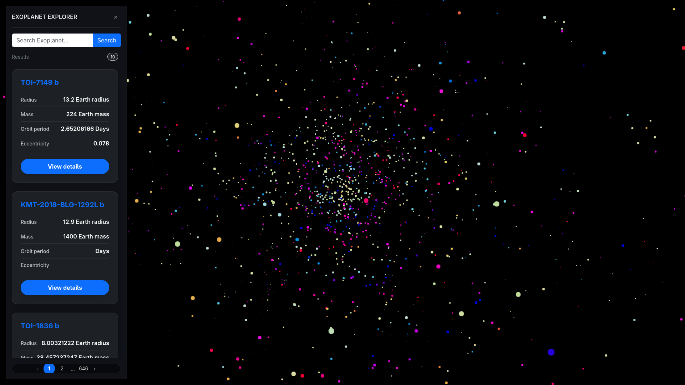

# NASA Exoplanet Visualizer

A 3D interactive application for exploring exoplanets and their planetary systems using data from NASA's Exoplanet Archive.

## Demo

Watch the application in action:

[](./assets/demo.mp4)

## Features

- Interactive 3D visualization of planetary systems.
- Search and explore exoplanets.
- Visualize planetary orbits and movement.
- Follow planets using camera controls.
- Display information about exoplanets and their host stars.

## Technologies

- React
- TypeScript
- Three.js
- React Three Fiber
- React Three Drei
- Bootstrap
- Vite
- Bun

## Backend

This project uses a custom REST API that retrieves raw astronomical data from NASA's Exoplanet Archive, processes it, and provides structured data for the frontend.

**Backend repository:** [NASA Exoplanet API](YOUR_BACKEND_GITHUB_URL)

## Installation

Clone the repository:

```bash
git clone https://github.com/JaquinPM/nasa-exoplanet-visualizer.git
cd nasa-exoplanet-visualizer
```

Install dependencies:

```bash
bun install
```

Start the development server:

```bash
bun run dev
```

## Data Source

[NASA Exoplanet Archive](https://exoplanetarchive.ipac.caltech.edu/docs/TAP/usingTAP.html)
